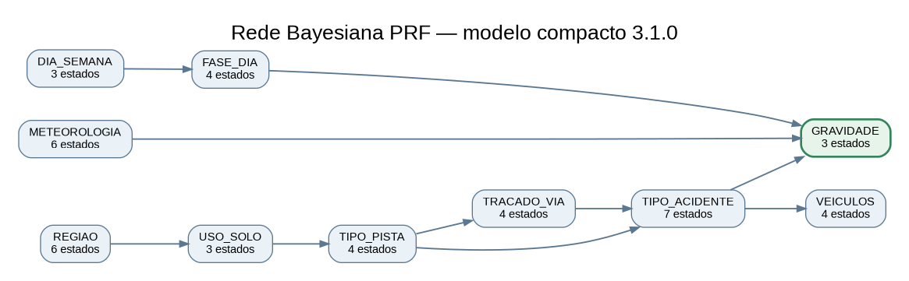

# Diagnóstico da Gravidade de Acidentes nas Rodovias Federais Brasileiras com Redes Bayesianas

**Alunos:** Caetano Vendrame Mantovani RA: 135846. Lorenzo Henrique Zanetti RA: 133076.

**Disciplina:** Aprendizagem de Máquina e Modelagem de Conhecimento Incerto (AMMCI) — UEM  
**Dataset:** PRF/DATATRAN, acidentes agrupados por ocorrência, 2021–2025.

> Este README concentra a documentação do projeto. O arquivo `modelo.json` é a representação estruturada exigida na especificação da disciplina. `config/parametros_cpt.json` é um arquivo de configuração editável, necessário para regenerar as CPTs; não é um documento adicional.

## 1. Objetivo e problema

Construir manualmente uma Rede Bayesiana discreta para analisar a distribuição de gravidade (sem vítimas, com vítimas feridas ou com vítimas fatais) de ocorrências registradas nas rodovias federais brasileiras.

**Pergunta principal:** dadas as características registradas de uma ocorrência — especialmente tipo de acidente, condição meteorológica e fase do dia — qual é a distribuição de probabilidade entre ocorrência sem vítimas, com vítimas feridas e com vítimas fatais?

O modelo tem finalidade diagnóstica sobre ocorrências já registradas. Não prevê a ocorrência de acidentes antes de acontecerem e não estima risco por trecho, quilômetro, pessoa ou veículo-quilômetro.

## 2. Dataset e preparação

Foram integrados cinco arquivos DATATRAN anuais, agrupados por ocorrência:

| Ano | Registros lidos | Registros com gravidade válida | Excluídos |
|---|---:|---:|---:|
| 2021 | 64.567 | 64.566 | 1 |
| 2022 | 64.606 | 64.605 | 1 |
| 2023 | 67.766 | 67.765 | 1 |
| 2024 | 73.202 | 73.201 | 1 |
| 2025 | 72.529 | 72.528 | 1 |
| **Total** | **342.670** | **342.665** | **5** |

As cinco linhas sem classificação válida de gravidade foram excluídas. Cada linha representa uma ocorrência, evitando contar um mesmo acidente uma vez para cada pessoa envolvida.

Fontes oficiais:
- [Portal de Dados Abertos da PRF](https://www.gov.br/prf/pt-br/acesso-a-informacao/dados-abertos/dados-abertos-da-prf)
- [Dicionário de dados de acidentes da PRF](https://www.gov.br/prf/pt-br/acesso-a-informacao/dados-abertos/dicionario-acidentes)

Os CSVs originais podem ser obtidos no portal oficial da PRF.

## 3. Variáveis, estados e pais

A rede contém dez variáveis discretas:

| ID | Variável | Estados | Pais |
|---|---|---|---|
| `DIA_SEMANA` | Dia da semana | Dia útil; Fim de semana; Ignorado | — |
| `FASE_DIA` | Fase do dia | Pleno dia; Transição; Plena noite; Ignorada | `DIA_SEMANA` |
| `METEOROLOGIA` | Condição meteorológica | Céu claro/sol; Nublado; Chuva/garoa; Neblina/nevoeiro; Outras adversas; Ignorada | — |
| `REGIAO` | Macrorregião | Norte; Nordeste; Centro-Oeste; Sudeste; Sul; Ignorada | — |
| `USO_SOLO` | Uso do solo | Urbano; Rural; Ignorado | `REGIAO` |
| `TIPO_PISTA` | Tipo de pista | Simples; Dupla; Múltipla; Ignorada | `USO_SOLO` |
| `TRACADO_VIA` | Traçado da via | Reta; Curva; Cruzamento; Outros/ignorado | `TIPO_PISTA` |
| `TIPO_ACIDENTE` | Tipo de acidente | Colisão frontal; Colisão traseira; Outras colisões; Saída de pista/capotamento/tombamento; Atropelamento de pedestre; Atropelamento de animal; Outros/ignorado | `TIPO_PISTA`, `TRACADO_VIA` |
| `VEICULOS` | Quantidade de veículos | 1; 2; 3 ou mais; Ignorada | `TIPO_ACIDENTE` |
| `GRAVIDADE` | Gravidade da ocorrência | Sem vítimas; Com vítimas feridas; Com vítimas fatais | `TIPO_ACIDENTE`, `METEOROLOGIA`, `FASE_DIA` |

No campo PRF `uso_solo`, `Sim` corresponde a urbano e `Não` corresponde a rural. Amanhecer e anoitecer são agrupados em `Transição`. Campos que definem diretamente a gravidade (quantidade de mortos, feridos e pessoas envolvidas) não são utilizados como evidências para inferir a gravidade.

## 4. Estrutura da Rede Bayesiana



Arestas do DAG:

1. `DIA_SEMANA → FASE_DIA`;
2. `REGIAO → USO_SOLO`;
3. `USO_SOLO → TIPO_PISTA`;
4. `TIPO_PISTA → TRACADO_VIA`;
5. `TIPO_PISTA → TIPO_ACIDENTE`;
6. `TRACADO_VIA → TIPO_ACIDENTE`;
7. `TIPO_ACIDENTE → VEICULOS`;
8. `TIPO_ACIDENTE → GRAVIDADE`;
9. `METEOROLOGIA → GRAVIDADE`;
10. `FASE_DIA → GRAVIDADE`.

### 4.1. Justificativa resumida das dependências

- `DIA_SEMANA → FASE_DIA`: representa uma distribuição temporal condicionada ao tipo de dia. É uma simplificação estatística e não afirma que o dia da semana cause a fase do dia.
- `REGIAO → USO_SOLO`: representa diferenças de contexto territorial entre macrorregiões.
- `USO_SOLO → TIPO_PISTA`: representa associação entre contexto urbano/rural e configuração de pista.
- `TIPO_PISTA → TRACADO_VIA`: simplificação para representar a distribuição de traçados entre categorias de pista; não significa que a pista determine a geometria.
- `TIPO_PISTA, TRACADO_VIA → TIPO_ACIDENTE`: contextualizam os tipos de ocorrência possíveis. A literatura discute diferenças por configuração viária, mas os efeitos dependem de detalhes não observados no dataset.
- `TIPO_ACIDENTE → VEICULOS`: quantidade de veículos é relacionada ao tipo de ocorrência e pode servir como evidência diagnóstica indireta.
- `TIPO_ACIDENTE, METEOROLOGIA, FASE_DIA → GRAVIDADE`: representam os três fatores diretamente considerados na CPT-alvo compacta.

As setas representam dependências da fatoração probabilística proposta pela equipe. Não comprovam causalidade.

### 4.2. Hipótese de independência condicional

A simplificação central assume que, uma vez conhecidos `TIPO_ACIDENTE`, `METEOROLOGIA` e `FASE_DIA`, a variável `GRAVIDADE` é condicionalmente independente de `REGIAO`, `USO_SOLO`, `TIPO_PISTA`, `TRACADO_VIA`, `VEICULOS` e `DIA_SEMANA`.

Essa hipótese diminui a CPT, mas pode omitir efeitos residuais reais de infraestrutura, exposição, velocidade, ocupação, socorro e outras características não representadas. Deve ser apresentada como limitação deliberada do modelo.

## 5. Construção manual das CPTs

O modelo contém 210 linhas de distribuições condicionais:

| Variável | Configurações de pais / linhas CPT |
|---|---:|
| `DIA_SEMANA` | 1 |
| `FASE_DIA` | 3 |
| `METEOROLOGIA` | 1 |
| `REGIAO` | 1 |
| `USO_SOLO` | 6 |
| `TIPO_PISTA` | 3 |
| `TRACADO_VIA` | 4 |
| `TIPO_ACIDENTE` | 16 |
| `VEICULOS` | 7 |
| `GRAVIDADE` | 168 |
| **Total** | **210** |


**Não é utilizado algoritmo de aprendizagem de estrutura, estimação automática de CPTs ou modelo previamente treinado.** As frequências descritivas da PRF contextualizam os dados; apenas os priors de meteorologia e região foram escolhidos manualmente como aproximações críticas dessas frequências. Nenhum ajuste estatístico automático foi executado.

### 5.1. Editar probabilidades

Edite `config/parametros_cpt.json`, não `modelo.json`. O arquivo de parâmetros contém:

| Chave | Função |
|---|---|
| `root_priors` | Priors de dia da semana, meteorologia e região |
| `fase_dia_by_day` | CPT de fase do dia |
| `uso_solo_by_region` | CPT de uso do solo |
| `tipo_pista_by_land` | CPT de tipo de pista |
| `tracado_by_tipo_pista` | CPT de traçado |
| `type_base` | Distribuição-âncora de tipo de acidente |
| `type_geometry_multipliers` | Ajustes do tipo de acidente por traçado |
| `tipo_pista_multipliers` | Ajustes do tipo de acidente por pista |
| `vehicles_by_type` | CPT de quantidade de veículos |
| `severity_base_by_type` | Distribuição-âncora de gravidade por tipo de acidente |
| `severity_multipliers` | Ajustes da gravidade por meteorologia e fase do dia |

Ordem dos vetores:
- Gravidade: `[Sem vítimas, Com vítimas feridas, Com vítimas fatais]`.
- Meteorologia: `[Céu claro/sol, Nublado, Chuva/garoa, Neblina/nevoeiro, Outras adversas, Ignorada]`.
- Região: `[Norte, Nordeste, Centro-Oeste, Sudeste, Sul, Ignorada]`.
- Tipo de acidente: `[Colisão frontal, Colisão traseira, Outras colisões, Saída de pista/capotamento/tombamento, Atropelamento de pedestre, Atropelamento de animal, Outros/ignorado]`.

Depois de editar, execute `python modelo_builder.py` para regenerar o `modelo.json`, os testes e os cenários. Vetores de distribuição devem somar 1; multiplicadores devem ser positivos. Registre a justificativa de toda alteração e compare os resultados antes/depois.

## 6. Cenários de utilização e resultados

O projeto implementa quatro consultas reais ao motor de inferência. Os números são resultados do modelo manual atual, não frequências observadas nem probabilidades calibradas com a PRF.

| Cenário | Sem vítimas | Feridas | Fatais |
|---|---:|---:|---:|
| Colisão frontal em céu claro durante o dia | 6,79% | 65,68% | 27,53% |
| Atropelamento de pedestre em céu claro durante o dia | 4,84% | 63,51% | 31,66% |
| Saída de pista sob neblina durante a noite | 16,49% | 72,82% | 10,68% |
| Apenas evidência de três ou mais veículos | 15,84% | 73,11% | 11,06% |

**Evidências dos cenários:**

1. Cenário 1: `TIPO_ACIDENTE=Colisão frontal`; `METEOROLOGIA=Céu claro/sol`; `FASE_DIA=Pleno dia`.
2. Cenário 2: `TIPO_ACIDENTE=Atropelamento de pedestre`; `METEOROLOGIA=Céu claro/sol`; `FASE_DIA=Pleno dia`.
3. Cenário 3: `TIPO_ACIDENTE=Saída de pista/capotamento/tombamento`; `METEOROLOGIA=Neblina/nevoeiro`; `FASE_DIA=Plena noite`.
4. Cenário 4: somente `VEICULOS=3 ou mais`. O tipo de acidente e as demais condições não são informados; a rede integra as distribuições condicionais e os priors.

As probabilidades podem ser interpretadas como as crenças produzidas pela rede dada sua estrutura e suas CPTs. Não devem ser apresentadas como taxas reais de fatalidade observadas em grupos equivalentes da PRF.

## 7. Como executar

**Requisito:** Python 3.10 ou superior. O projeto utiliza apenas a biblioteca padrão do Python; não há dependências externas obrigatórias.

Na pasta base, execute:

### 7.1. Regenerar a rede e as CPTs

```bash
python modelo_builder.py
```

### 7.2. Executar todos os testes

```bash
python -m unittest discover -s tests -v
```

### 7.3. Executar os quatro cenários

```bash
python executar_cenarios.py
```

Os resultados são gravados em `data/resultados_cenarios.json`. A pasta `data/` é criada automaticamente.

### 7.4. Fazer uma consulta própria

```bash
python inferencia.py --query GRAVIDADE --evidence "TIPO_ACIDENTE=Colisão frontal" "METEOROLOGIA=Céu claro/sol" "FASE_DIA=Pleno dia"
```

### 7.5. Reprocessar os dados originais (caso não tenha os dados)

1. Baixe no portal da PRF os arquivos DATATRAN anuais de 2021, 2022, 2023, 2024 e 2025, agrupados por ocorrência.
2. Extraia os CSVs `datatran2021.csv` até `datatran2025.csv` e coloque no workspace.
3. Execute:

```bash
python preprocessar_prf.py --input datatran2021.csv datatran2022.csv datatran2023.csv datatran2024.csv datatran2025.csv --output data/ocorrencias_tratadas_2021_2025.csv --summary data/resumo_descritivo_2021_2025.json
```

O pré-processador integra, limpa, discretiza e descreve os registros. **Ele não aprende a estrutura nem estima automaticamente as CPTs.** Os arquivos CSV completos não são necessários para executar a inferência ou os testes incluídos no pacote.

## 8. Arquivos incluídos

```text
prf_rede_bayesiana/
├── README.md                       # Documentação centralizada
├── modelo.json                     # Modelo estruturado exigido na disciplina
├── modelo_builder.py               # Estrutura da rede e geração manual das CPTs
├── inferencia.py                   # Validação e inferência exata
├── executar_cenarios.py             # Execução dos quatro cenários
├── preprocessar_prf.py              # Pré-processamento dos CSVs oficiais
├── config/
│   └── parametros_cpt.json          # Parâmetros manuais editáveis
├── tests/
│   ├── test_rede.py                 # DAG, CPTs, inferência e cenários
│   └── test_preprocessar.py         # Mapeamento e discretização
├── fixtures/
│   └── exemplo_prf_sintetico.csv    # Amostra sintética apenas para testes
├── rede.png                         # Diagrama para leitura/apresentação
├── rede.dot                         # Fonte textual do diagrama
├── requirements.txt                # Registro de dependências
└── .gitignore
```

O `modelo.json` contém identificação do projeto, dataset e fonte; variáveis, descrições e estados; dependências direcionadas; CPTs completas; cenários e metadados de execução. O `README.md` concentra a documentação, decisões, fontes, instruções e limitações.

## 9. Testes automatizados

A suíte automatizada verifica:
- existência das dez variáveis e ausência de ciclos;
- presença das dez arestas previstas;
- completude das CPTs e soma das distribuições;
- dimensões de cada CPT, incluindo 168 configurações de `GRAVIDADE`;
- correspondência entre parâmetros editáveis e `modelo.json` gerado;
- priors de meteorologia e região adotados pela equipe;
- execução dos quatro cenários e normalização das consultas;
- rejeição de evidências inválidas;
- mapeamento de campos e categorias do pré-processamento.

Resultado da última execução: **30 testes aprovados**. Execute os comandos da seção 7 novamente após qualquer alteração nos parâmetros ou no código.

## 10. Uso de Inteligência Artificial

Foi utilizada como apoio à decisão e implementação a ferramenta de inteligência artificial ChatGPT, na qual a mesma auxiliou a equipe na estruturação geral do pipeline, na organização geral, tanto textual quanto de ideias, e para fins de pesquisa quanto à fundamentação teórica utilizada para decidir as porcentagens das CPTs. A equipe revisou as fontes, validou os códigos, conferiu as probabilidades, executou os testes e o uso efetivamente realizado foi conforme as normas institucionais da Universidade Estadual de Maringá. A responsabilidade pelo conteúdo e pelas decisões de modelagem permanece com os integrantes.

## 11. Referências principais

- POLÍCIA RODOVIÁRIA FEDERAL (PRF). **Dados Abertos da PRF — acidentes de trânsito**. [Portal oficial](https://www.gov.br/prf/pt-br/acesso-a-informacao/dados-abertos/dados-abertos-da-prf).
- PRF. **Dicionário de dados de acidentes (sistema BAT)**. [Documentação oficial](https://www.gov.br/prf/pt-br/acesso-a-informacao/dados-abertos/dicionario-acidentes).
- FRANCESCHI, L. et al. (2022). *Fatores relacionados à severidade de acidentes em rodovias no Brasil através de um modelo de regressão logística multinomial*. Transportes, 30(1). [https://doi.org/10.14295/transportes.v30i1.2566](https://doi.org/10.14295/transportes.v30i1.2566).
- BARROSO JUNIOR, G. T.; BERTHO, A. C. S.; VEIGA, A. C. (2019). *A letalidade dos acidentes de trânsito nas rodovias federais brasileiras em 2016*. Revista Brasileira de Estudos de População, 36. [https://doi.org/10.20947/S0102-3098a0074](https://doi.org/10.20947/S0102-3098a0074). Unidade de análise e desfecho diferem da gravidade por ocorrência utilizada neste projeto.
- OBSERVATÓRIO NACIONAL DE SEGURANÇA VIÁRIA / UFPR (2026). *Estudo revela o perfil da sinistralidade nas rodovias federais brasileiras*. [Matéria institucional](https://www.onsv.org.br/comunicacao/materias/estudo-revela-o-perfil-da-sinistralidade-nas-rodovias-federais-brasileiras).
- ANDRIOLA, C. L.; TORRES, T. B.; GARCÍA, D. S. P. (2019). *Influência dos parâmetros geométricos de rodovias na frequência e severidade de acidentes viários em curvas: o caso da BR 116*. Transportes, 27(3). [https://doi.org/10.14295/transportes.v27i3.1997](https://doi.org/10.14295/transportes.v27i3.1997).

As fontes sustentam definições, contexto e tendências qualitativas. Nenhuma delas fornece diretamente as 168 linhas da CPT de gravidade com os mesmos estados e a mesma unidade de análise.